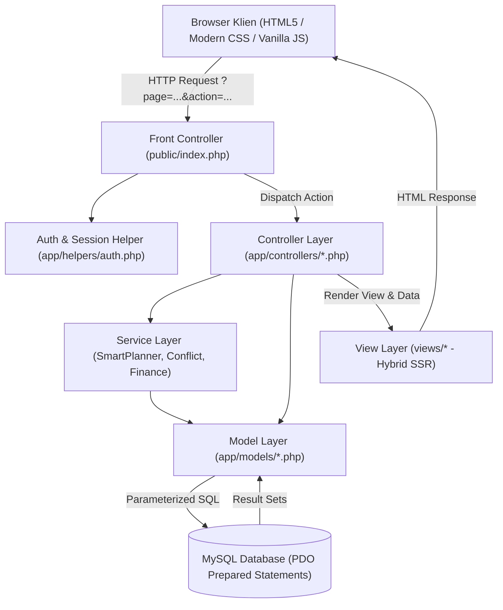

# CampusOS — Web-Based Student Assistant

[](https://www.php.net/)
[](https://www.mysql.com/)
[](#arsitektur--tech-stack)
[](#keamanan--data-isolation)
[-C8F538?style=flat&labelColor=111317&color=C8F538)](#desain-antarmuka--pengalaman-pengguna)

> **Judul Proyek Akademik:**  
> *Pengembangan Aplikasi Asisten Mahasiswa Berbasis Web dengan Integrasi Manajemen Akademik, Perencanaan Aktivitas, dan Pengelolaan Keuangan Pribadi.*

---

## 📌 Daftar Isi

1. [Tentang CampusOS](#-tentang-campusos)
2. [Fitur Utama Sistem](#-fitur-utama-sistem)
   - [1. Autentikasi & Isolasi Sesi Pengguna](#1-autentikasi--isolasi-sesi-pengguna)
   - [2. Dashboard Ringkasan Bento Grid](#2-dashboard-ringkasan-bento-grid)
   - [3. Manajemen Akademik & Deteksi Bentrok](#3-manajemen-akademik--deteksi-bentrok-jadwal)
   - [4. Kalender Kegiatan Terpadu](#4-kalender-kegiatan-terpadu)
   - [5. Manajemen Tugas & Smart Planner](#5-manajemen-tugas--smart-planner-berbasis-prioritas)
   - [6. Keuangan Pribadi & Proyeksi Burn Rate](#6-keuangan-pribadi--proyeksi-burn-rate)
3. [Arsitektur & Tech Stack](#-arsitektur--tech-stack)
4. [Struktur Direktori](#-struktur-direktori)
5. [Panduan Instalasi Lokal (Laragon)](#-panduan-instalasi-lokal-laragon)
6. [Akun Demo Mahasiswa](#-akun-demo-mahasiswa)
7. [Tim Pengembang & Pembimbing](#-tim-pengembang--pembimbing)
8. [Dokumentasi Teknis](#-dokumentasi-teknis)

---

## 📖 Tentang CampusOS

Mahasiswa perguruan tinggi menghadapi tantangan multidimensi dalam menjalani kehidupan perkuliahan: menjaga kehadiran kuliah tetap disiplin, menyelesaikan berbagai tenggat tugas akademik, menyeimbangkan agenda kegiatan organisasi/pribadi, hingga mengontrol pengeluaran uang saku bulanan agar tidak mengalami defisit. Sering kali mahasiswa menggunakan aplikasi terpisah-pisah untuk to-do list, kalender, dan catatan pengeluaran, yang berujung pada bentrok jadwal, stres akibat tenggat waktu (*burnout*), serta ketidakstabilan finansial.

**CampusOS** hadir sebagai platform asisten produktivitas terpadu berbasis web yang dirancang khusus untuk memecahkan permasalahan tersebut. Dibangun menggunakan arsitektur **Pure PHP 8+ Native (MVC + Service Layer)** tanpa ketergantungan framework eksternal, CampusOS mengutamakan:
- **Pendekatan Deterministik & Transparan:** Mesin rekomendasi jadwal belajar (*Smart Planner*) dan deteksi bentrok (*Conflict Detection*) bekerja dengan rumus matematis murni tanpa *black-box* AI eksternal.
- **Isolasi Data Tingkat Pengguna (Multi-User Data Isolation):** Keamanan menyeluruh pada seluruh layer aplikasi dengan kepatuhan query `WHERE user_id = :user_id` untuk mencegah kerentanan IDOR (*Insecure Direct Object References*).
- **Desain Modern Bento Grid Hybrid SSR:** Antarmuka responsif berkinerja tinggi (*High-Contrast Dark Canvas & Electric Lime Accents*) dengan dukungan transisi tema dinamis (*View Transitions API*).

---

## ✨ Fitur Utama Sistem

### 1. Autentikasi & Isolasi Sesi Pengguna
- **Controller:** `app/controllers/AuthController.php`
- **Helper:** `app/helpers/auth.php`
- Fitur masuk (*login*) dan keluar (*logout*) akun berbasis sesi PHP yang aman.
- Pengamanan cookie sesi dengan konfigurasi `session.cookie_httponly = 1` dan `session.use_only_cookies = 1`.
- Regenerasi ID sesi (`session_regenerate_id(true)`) saat otentikasi berhasil untuk mencegah serangan *Session Fixation*.
- Kredensial akun dienkripsi menggunakan hashing standar industri `password_hash()` (Bcrypt).
- Fallback akun demo otomatis jika database belum terisi penuh.

### 2. Dashboard Ringkasan Bento Grid
- **Controller:** `app/controllers/DashboardController.php`
- **View:** `views/dashboard/index.php`
- Agregasi data lintas modul secara *real-time* ke dalam tata letak visual Bento Grid:
  - **4 Metrik KPI Utama:** Total SKS semester aktif, jumlah tugas aktif & prioritas tinggi, total estimasi beban studi, dan sisa pagu anggaran bulanan.
  - **Grafik Beban Belajar Mingguan:** Visualisasi CSS Bar Chart vertikal interaktif yang merangkum alokasi jam belajar per hari (Senin–Minggu).
  - **Timeline Penugasan Mendesak:** *Horizontal timeline bars* yang menampilkan kedekatan tenggat waktu dan estimasi durasi pengerjaan.
  - **Jadwal Kuliah Hari Ini:** Menampilkan kelas rutin yang harus dihadiri pada hari berjalan beserta informasi ruangan.
  - **Preview Rekomendasi Smart Planner:** Slot waktu belajar mandiri paling optimal yang disarankan oleh mesin pintar.

### 3. Manajemen Akademik & Deteksi Bentrok Jadwal
- **Controller:** `app/controllers/AcademicController.php`
- **Models:** `app/models/CourseModel.php`, `app/models/ScheduleModel.php`
- **Service:** `app/services/ConflictService.php`
- **View:** `views/academic/index.php`
- **Katalog Mata Kuliah:** CRUD data mata kuliah lengkap dengan kode MK, nama mata kuliah, dosen pengampu, bobot SKS (1–6), dan warna label kustom (hex color).
- **Jadwal Perkuliahan Mingguan:** Pengelompokan sesi kuliah berulang per hari (Senin s/d Minggu).
- **Deteksi Bentrok Deterministik (Conflict Detection Engine):**
  Sebelum jadwal perkuliahan baru disimpan ke basis data, sistem wajib memanggil `ConflictService` untuk memverifikasi tidak adanya irisan waktu terhadap jadwal kuliah lain maupun agenda kegiatan mahasiswa.
  - **Rumus Irisan Waktu Matematis:**
    $$(\text{start}_A < \text{end}_B) \land (\text{end}_A > \text{start}_B)$$
  - **Toleransi Batas Tepi (Boundary Adjacency):** Jadwal yang bersebelahan persis (contoh: Sesi 1 selesai pukul 10:00 dan Sesi 2 mulai pukul 10:00) dipastikan **aman dan tidak dianggap bentrok**.

### 4. Kalender Kegiatan Terpadu
- **Controller:** `app/controllers/CalendarController.php`
- **Models:** `app/models/EventModel.php`, `app/models/ScheduleModel.php`, `app/models/TaskModel.php`
- **View:** `views/calendar/index.php`
- **Matriks Grid Bulanan:** Menampilkan kalender bulanan lengkap dengan indikator titik warna (*color dots*) untuk membedakan:
  - 🔵 **Kuliah Tetap** (Jadwal mingguan berulang)
  - 🟠 **Agenda Kegiatan** (Organisasi, pribadi, belajar mandiri, ujian)
  - 🟡 **Deadline Tugas** (Batas pengumpulan tugas akademik)
- **Panel Agenda Harian (Selected Day Panel):** Menampilkan rincian agenda per tanggal yang dipilih, lengkap dengan jam mulai-selesai, lokasi kegiatan, dan catatan tambahan.
- **Validasi Anti-Bentrok Agenda:** Validasi real-time saat menambah atau memperbarui agenda kegiatan agar tidak menimpa jam perkuliahan wajib.

### 5. Manajemen Tugas & Smart Planner Berbasis Prioritas
- **Controller:** `app/controllers/TaskController.php`
- **Models:** `app/models/TaskModel.php`
- **Service:** `app/services/SmartPlannerService.php`
- **Views:** `views/tasks/index.php`, `views/planner/index.php`
- **Pelacakan Tugas Kuliah:**
  - CRUD tugas akademik dengan penentuan tanggal/jam deadline, estimasi pengerjaan (jam), bobot prioritas (`low`, `medium`, `high`), dan mata kuliah terkait.
  - Fitur *Quick Status Toggle* untuk mencentang status penyelesaian tugas langsung dari tabel antarmuka.
  - Filter interaktif berdasarkan status (`pending`, `in_progress`, `done`), prioritas, mata kuliah, dan pencarian teks judul/deskripsi.
- **Mesin Rekomendasi Cerdas (Smart Planner):**
  - **Perhitungan Skor Urgensi ($U$):**
    $$U = \left( \frac{\text{Estimasi Jam}}{\max(T_{\text{remaining}}, 1)} \right) \times W_p \times 100$$
    *Keterangan:* $T_{\text{remaining}}$ adalah sisa waktu menuju deadline dalam jam, $W_p$ adalah bobot prioritas ($High = 1.5, Medium = 1.2, Low = 1.0$), dengan penalti urgensi ekstra (+100) untuk tugas yang telah melewati deadline (*overdue*).
  - **Pemetaan Celah Waktu Luang (Free Time Gaps):** Sistem mengevaluasi rentang jam belajar preferensi mahasiswa (`planning_preferences`), lalu memotong waktu yang telah terisi oleh kuliah tetap atau agenda lain untuk menemukan celah kosong minimal 30 menit.
  - **Hard Guardrail:** Rekomendasi bersifat saran mandiri dan **tidak pernah mengubah jadwal kuliah tetap secara sepihak**.
  - **Alasan Transparan (Transparent Reasoning):** Setiap slot rekomendasi menyajikan narasi penjelasan mengapa tugas tersebut diprioritaskan dan mengapa slot waktu tersebut dipilih.
  - **One-Click Approval:** Tombol persetujuan untuk menyimpan rekomendasi belajar ke kalender kegiatan mahasiswa secara permanen.

### 6. Keuangan Pribadi & Proyeksi Burn Rate
- **Controller:** `app/controllers/FinanceController.php`
- **Model:** `app/models/FinanceModel.php`
- **Service:** `app/services/FinanceService.php`
- **View:** `views/finance/index.php`
- **Pencatatan Arus Kas:** Mencatat transaksi pemasukan (*income*) dan pengeluaran (*expense*) lengkap dengan kategori (Konsumsi, Transportasi, Pendidikan, Kost, Hiburan, dll.), nominal, tanggal, dan keterangan.
- **Manajemen Batas Anggaran (Budget Target):** Penetapan pagu pengeluaran bulanan (*monthly limit*) beserta ambang batas peringatan (*warning threshold percent*, default: 80%).
- **Analisis Deterministik & Proyeksi Akhir Bulan:**
  - **Rata-rata Pengeluaran Harian (*Daily Burn Rate*):** Dihitung berdasarkan akumulasi pengeluaran dibagi jumlah hari yang telah berjalan dalam bulan terkait.
  - **Proyeksi Total Pengeluaran (*Projected Total Expense*):** Memproyeksikan total dana yang akan terpakai hingga hari terakhir bulan tersebut berdasarkan *burn rate*.
  - **Proyeksi Sisa Saldo (*Projected End Balance*):** Mengestimasi saldo tersisa pada akhir bulan kalender.
  - **Status Peringatan Defisit:** Otomatis mendeteksi status **Aman** (*Safe*), **Waspada** (*Near Limit*), atau **Kritis/Defisit** (*Over Budget*) lengkap dengan pesan rekomendasi finansial dalam bahasa Indonesia.
- **Distribusi Kategori Pengeluaran:** Ringkasan persentase dan nominal pengeluaran per kategori untuk evaluasi alokasi dana mahasiswa.

---

## 🛠️ Arsitektur & Tech Stack



| Komponen | Teknologi | Keterangan |
| :--- | :--- | :--- |
| **Bahasa Pemrograman** | PHP 8.1+ (Pure Native) | Tanpa framework berat (Laravel/CodeIgniter); menggunakan pola arsitektur MVC + Service Layer murni. |
| **Basis Data** | MySQL 8.0+ / MariaDB | Relasional (InnoDB Engine, utf8mb4), integritas data via Foreign Keys (`ON DELETE CASCADE` / `SET NULL`). |
| **Akses Basis Data** | PDO Prepared Statements | Parameter binding 100% pada semua query untuk menjamin imunitas terhadap SQL Injection. |
| **Frontend Styling** | Vanilla Modern CSS3 | Custom Design Tokens (`tokens.css`), Bento Grid Flex/Grid (`layout.css`), High-Contrast Dark & Light Theme via CSS Variables. |
| **Frontend Scripting** | Vanilla JavaScript (ES6+) | Modal deklaratif (`data-open-modal`), auto-populate form edit, dismissing alert, theme toggle via View Transitions API. |
| **Web Server Environment** | Apache / Nginx (Laragon) | Routing berbasis query string (`index.php?page=<modul>&action=<aksi>`). |

---

## 📂 Struktur Direktori

```text
CampusOS/
├── app/                              # Inti Logika Aplikasi (Backend)
│   ├── config/                       # Konfigurasi Database & Lingkungan
│   │   ├── config.example.php        # Template konfigurasi referensi
│   │   ├── config.local.php          # Konfigurasi aktif lokal (diabaikan git)
│   │   └── database.php              # Inisialisasi koneksi PDO Singleton
│   ├── controllers/                  # Controller HTTP Request Handler
│   │   ├── AcademicController.php    # Modul mata kuliah & jadwal perkuliahan
│   │   ├── AuthController.php        # Modul masuk & keluar akun
│   │   ├── CalendarController.php    # Modul kalender kegiatan terpadu
│   │   ├── DashboardController.php   # Modul dashboard ikhtisar bento grid
│   │   ├── FinanceController.php     # Modul pencatatan transaksi & anggaran
│   │   └── TaskController.php        # Modul tugas kuliah & preferensi belajar
│   ├── helpers/                      # Helper & Utilitas Global
│   │   ├── auth.php                  # Manajemen session, proteksi login & user context
│   │   └── view.php                  # Fungsi renderView(), sanitasi e(), setFlash()
│   ├── models/                       # Data Access Layer (PDO Prepared Statements)
│   │   ├── CourseModel.php           # CRUD tabel courses
│   │   ├── EventModel.php            # CRUD tabel events
│   │   ├── FinanceModel.php          # CRUD transactions & budget_settings
│   │   ├── ScheduleModel.php         # CRUD tabel class_schedules
│   │   └── TaskModel.php             # CRUD tasks & planning_preferences
│   └── services/                     # Business Logic & Algoritma Deterministik
│       ├── ConflictService.php       # Mesin deteksi bentrok irisan waktu
│       ├── FinanceService.php        # Kalkulasi burn rate & proyeksi saldo akhir
│       └── SmartPlannerService.php   # Mesin rekomendasi slot belajar mandiri
├── database/                         # Basis Data Relasional
│   ├── schema.sql                    # Skema tabel DDL (8 tabel relasional)
│   └── seed.sql                      # Data awal demonstrasi (Dummy data mahasiswa)
├── docs/                             # Dokumentasi Spesifikasi & Panduan
│   ├── architecture-and-db.md        # Arsitektur sistem & kamus data relasional
│   ├── design-system.md              # Panduan palet warna & tipografi bento grid
│   ├── product-spec.md               # User stories, problem statement & MVP scope
│   └── setup-and-workflow.md         # Alur kerja kolaborasi Git & setup server
├── public/                           # Web Server Public Root
│   ├── assets/                       # Berkas Aset Statis
│   │   ├── css/                      # tokens.css, layout.css, components.css
│   │   └── js/                       # ui.js (interaktivitas tema, modal, populator)
│   └── index.php                     # Front Controller & Dispatcher Routing
├── views/                            # Template Antarmuka Pengguna (Hybrid SSR)
│   ├── academic/index.php            # Tampilan modul jadwal & mata kuliah
│   ├── auth/login.php                # Tampilan halaman masuk akun
│   ├── calendar/index.php            # Tampilan matriks kalender kegiatan
│   ├── dashboard/index.php           # Tampilan ikhtisar dashboard bento grid
│   ├── finance/index.php             # Tampilan modul keuangan pribadi
│   ├── layouts/main.php              # Master layout shell (topbar, sidebar, modal)
│   ├── planner/index.php             # Tampilan rekomendasi Smart Planner
│   └── tasks/index.php               # Tampilan manajemen tugas kuliah
├── AGENTS.md                         # Standard Operating Procedures & Hard Guardrails
└── README.md                         # Dokumentasi Utama Proyek
```

---

## 🚀 Panduan Instalasi Lokal (Laragon)

Ikuti langkah-langkah di bawah ini untuk menjalankan CampusOS di lingkungan lokal Windows menggunakan Laragon:

### 1. Prasyarat Sistem
- Pasang [Laragon](https://laragon.org/download/) (disarankan edisi Full dengan PHP 8.1+ dan MySQL 8.0+).
- Git for Windows.
- Web Browser modern (Google Chrome, Microsoft Edge, atau Mozilla Firefox).

### 2. Kloning Repositori
Buka terminal (Laragon Terminal atau PowerShell) dan arahkan ke direktori web root Laragon (`C:\laragon\www`), lalu lakukan *clone*:
```bash
cd C:\laragon\www
git clone https://github.com/<username>/CampusOS.git
cd CampusOS
```

### 3. Jalankan Service Laragon
1. Buka aplikasi **Laragon**.
2. Klik tombol **Start All** untuk menyalakan service **Apache** dan **MySQL**.

### 4. Buat Basis Data & Impor Skema
Buka database manager bawaan Laragon (**HeidiSQL**) atau **phpMyAdmin** (`http://localhost/phpmyadmin`), kemudian:
1. Buat basis data baru bernama `campus_os` (atau `campusos_db`):
   ```sql
   CREATE DATABASE `campus_os` CHARACTER SET utf8mb4 COLLATE utf8mb4_unicode_ci;
   ```
2. Pilih database `campus_os`, lalu impor file skema tabel secara berurutan:
   - Impor skema: [`database/schema.sql`](database/schema.sql)
   - Impor data awal demo: [`database/seed.sql`](database/seed.sql)

> [!TIP]
> Jika menggunakan command prompt / terminal Laragon, impor dapat dijalankan langsung via CLI:
> ```bash
> mysql -u root -p campus_os < database/schema.sql
> mysql -u root -p campus_os < database/seed.sql
> ```

### 5. Konfigurasi Lingkungan Lokal
Buat berkas konfigurasi lokal di `app/config/config.local.php` (berkas ini diabaikan oleh Git untuk keamanan kredensial). Salin dari contoh `app/config/config.example.php` atau buat dengan isi berikut:

```php
<?php
// app/config/config.local.php

return [
    'db' => [
        'host'     => '127.0.0.1',
        'dbname'   => 'campus_os',
        'username' => 'root',
        'password' => '',
        'charset'  => 'utf8mb4',
    ],
    'app_name' => 'CampusOS',
    'app_env'  => 'development',
    'debug'    => true,
];
```

### 6. Akses Aplikasi di Browser
Buka browser favorit Anda dan akses alamat berikut:
- **Alamat URL Virtual Host Laragon:**
  ```text
  http://campusos.test
  ```
- **Atau via URL Jalur Subdirektori:**
  ```text
  http://localhost/CampusOS/public/
  ```

---

## 👤 Akun Demo Mahasiswa

Untuk mempermudah pengujian seluruh alur aplikasi, telah disediakan data awal (*seed data*) akun mahasiswa aktif:

| Parameter | Kredensial Demo |
| :--- | :--- |
| **Alamat Email** | `mahasiswa@campusos.test` |
| **Kata Sandi** | `password123` |
| **Nama Mahasiswa** | Demo Mahasiswa |
| **Status Akademik** | Semester 3 (Teknik Informatika) |
| **Beban Studi Demo** | 3 Mata Kuliah aktif, 3 Jadwal Kuliah rutin mingguan |
| **Data Agenda Demo** | 2 Agenda kegiatan (Rapat BEM Fakultas & Kelompok Belajar) |
| **Data Tugas Demo** | 4 Tugas kuliah dengan berbagai variasi deadline & tingkat prioritas |
| **Data Keuangan Demo**| Saldo awal, batas anggaran bulanan Rp 1.500.000, dan beberapa riwayat transaksi |

> [!NOTE]
> Jika database belum diimpor atau koneksi terputus sementara, sistem memiliki fitur otentikasi *fallback* otomatis untuk akun demo di atas sehingga Anda tetap dapat masuk dan mengeksplorasi antarmuka aplikasi.

---

## 👥 Tim Pengembang & Pembimbing

Proyek ini dikembangkan oleh Tim Pengembang Mahasiswa dalam rangka pemenuhan tugas besar mata kuliah **Pemrograman Web**:

- **Adam Rafiq Arrasyid**  
  *Peran:* **UI/UX & Frontend Engineer**  
  *Fokus:* Design System Bento Grid, Slicing antarmuka modular di `views/`, High-Contrast Dark & Light Mode tokens, komponen layout responsif, dan interaktivitas JavaScript ES6+ (`public/assets/`).

- **Fakhriy Mubarak**  
  *Peran:* **Backend & System Logic Engineer**  
  *Fokus:* Arsitektur MVC Native, perancangan skema relasional database MySQL (`database/`), keamanan PDO Prepared Statements, modul autentikasi sesi, mesin deteksi bentrok jadwal (`ConflictService`), mesin rekomendasi tugas (`SmartPlannerService`), serta analitik proyeksi keuangan (`FinanceService`).

**Dosen Pengampu:**  
**Vera Irma Delianti, M.Pd.T.**

---

## 📚 Dokumentasi Teknis

Dokumentasi rancangan mendalam dan arsitektur teknis tersedia pada folder [`docs/`](docs/):
- 📘 [Spesifikasi Produk (`docs/product-spec.md`)](docs/product-spec.md) — Problem statement, persona mahasiswa, user stories, dan batasan ruang lingkup fungsional.
- 📐 [Arsitektur & Desain Database (`docs/architecture-and-db.md`)](docs/architecture-and-db.md) — Pola MVC + Service, kamus data tabel, indeks database, dan isolasi multi-tenant.
- 🎨 [Design System & UI Guidelines (`docs/design-system.md`)](docs/design-system.md) — Filosofi Bento Grid, palet warna high-contrast, tipografi, dan token CSS.
- ⚙️ [Setup & Development Workflow (`docs/setup-and-workflow.md`)](docs/setup-and-workflow.md) — Alur kerja Git, standar kode PSR/clean PHP, dan prosedur deployment.

---

<div align="center">
  <sub>Dikembangkan dengan dedikasi untuk mendukung kesuksesan akademik dan literasi finansial mahasiswa Indonesia.</sub><br>
  <strong>CampusOS &copy; 2026 — All Rights Reserved.</strong>
</div>
